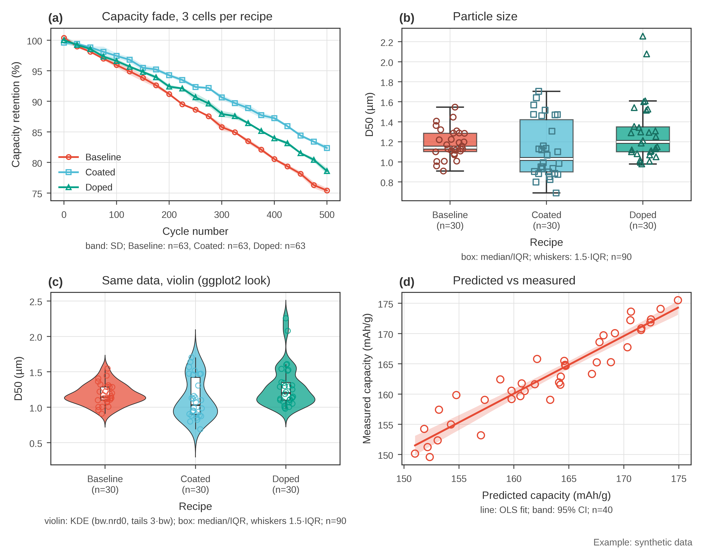
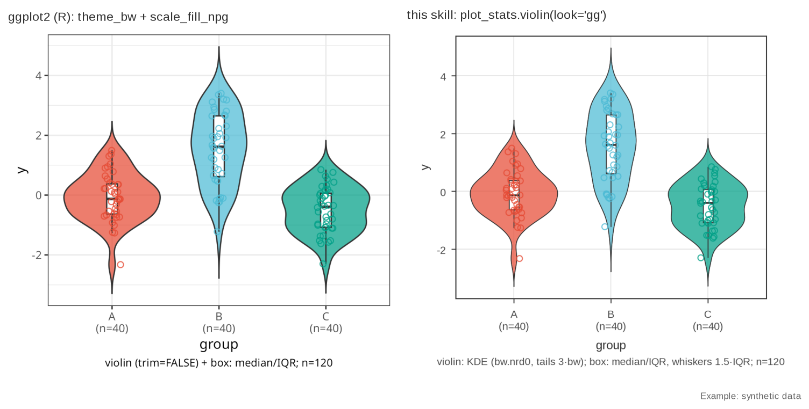

# research-plot-skill

[](https://github.com/catnap042/research-plot-skill/actions/workflows/ci.yml)
[](requirements.txt)
[](LICENSE)
[](skills/research-data-plotting/SKILL.md)

An Agent Skill that makes AI coding agents (and you) draw research figures in
matplotlib with one consistent, honest look: ggplot2 `theme_bw` layout, ggsci `npg`
colours, paper and slide presets.

## The problem

Ask an AI agent for "a capacity-fade plot" five times and you get five styles:
different fonts, filled markers in one figure and hollow in the next, error bands with
no statement of SD or CI, legends sitting on the data, slide figures with 8 pt text.
Fixing this by hand for every figure in a paper or a report is tedious, and agents
forget the fixes in the next session.

## The method

The skill gives the agent two things:

1. **Rules it reads** ([`SKILL.md`](skills/research-data-plotting/SKILL.md), with details in
   [`recipes.md`](skills/research-data-plotting/recipes.md)): which chart fits which data,
   how to encode meaning (one sample = one colour + one marker, measured data hollow,
   models solid, predictions dashed), sizes for paper (89/183 mm, 8 pt) and slides
   (18-20 pt), and honest-encoding rules (state SD/SE/CI and n, no dual y axes,
   disclose smoothing).
2. **Fixed helper scripts it calls** (pure matplotlib, in
   [`scripts/`](skills/research-data-plotting/scripts)):
   - `style.py`: presets (`use("paper")`, `use_talk()`), palettes (npg, jco, lancet,
     ggplot2 hue), hollow-marker / model / reference line styles, `save()` to PNG + PDF + SVG
     with editable text.
   - `plot_layout.py`: multi-panel figures with bold (a)/(b) labels, shared axes,
     edge colorbars and legends that do not overlap.
   - `plot_stats.py`: box + strip, violin (ggplot2 look), regression with CI, line with
     mean ± SD/SE/CI, scatter, facets. Each writes the error type and n under the axis
     and returns the numbers it computed.

Because the look lives in code, the agent cannot drift; because the rules live in
Markdown, it knows *which* chart to draw and what to disclose.

## Result

One call per panel, synthetic data, default preset:



The violin helper reproduces ggplot2 closely. Left: real R/ggplot2 render. Right: this
skill, same synthetic data ([how it was made](comparisons/)).



More: a 9-chart gallery (donut, sunburst, Sankey, stacked bar, heatmap, radar, violin,
waffle, waterfall) in five style sets: [default](docs/images/gallery/bw/_gallery_bw.png),
[talk](docs/images/gallery/talk/_gallery_talk.png),
[minimal](docs/images/gallery/minimal/_gallery_minimal.png),
[consulting](docs/images/gallery/consulting/_gallery_consulting.png),
[jco soft](docs/images/gallery/jco/_gallery_jco.png).

## 30-second quickstart

```bash
git clone https://github.com/catnap042/research-plot-skill
cd research-plot-skill
python -m pip install -r requirements.txt
python examples/quickstart.py          # -> out/quickstart.png / .pdf / .svg
```

Everything is synthetic and generated in the script; nothing is downloaded.
`python examples/make_gallery.py` rebuilds the gallery (needs `pillow`).

## Use it as an Agent Skill

The skill is the folder [`skills/research-data-plotting/`](skills/research-data-plotting).
Copy it where your agent looks for skills:

| Agent | Personal (all projects) | One project |
|---|---|---|
| Claude Code | `~/.claude/skills/research-data-plotting/` | `.claude/skills/research-data-plotting/` |
| Codex and other agents that read `.agents/skills` | `~/.agents/skills/research-data-plotting/` | `.agents/skills/research-data-plotting/` |

```bash
# Claude Code, personal install
mkdir -p ~/.claude/skills
cp -r skills/research-data-plotting ~/.claude/skills/
# Claude Code, one project (run in that project's root)
mkdir -p .claude/skills && cp -r /path/to/research-plot-skill/skills/research-data-plotting .claude/skills/
# Codex and other .agents/skills readers: same, with ~/.agents/skills or .agents/skills
```

The agent needs Python with `matplotlib`, `numpy`, `pandas` and `scipy`. Then just ask,
for example:

- "Plot capacity retention vs cycle for these three recipes, paper single column."
- "Make a slide-sized violin plot of D50 by supplier with the points shown."
- "Turn this figure into a 2x2 panel with shared y axes and (a)-(d) labels."

The agent reads `SKILL.md`, adds `scripts/` to `sys.path`, and calls the helpers.

### Without an agent

```python
import sys; sys.path.insert(0, "skills/research-data-plotting/scripts")
import style, plot_stats
style.use("paper", variant="C", palette="npg")   # or style.use_talk()
fig, ax = style.fig("single")
plot_stats.box_strip(ax, df, "recipe", "d50")    # df: your pandas DataFrame
style.finish(ax, "Recipe", "D50 (µm)")
style.save(fig, "out/d50")
```

## Limitations

- matplotlib only. No seaborn/Plotly; ultraplot is covered by notes in `recipes.md`, not code.
- The talk preset enlarges fonts and frames, but helper point sizes and violin outlines
  stay at paper size; pass `point_lw` or adjust if a slide looks thin.
- `plot_stats.lineplot` counts n as rows per group. If your rows are repeated
  measurements of a few cells, state the replicate unit yourself.
- Very long labels on donut/sunburst charts can still touch the ring at talk sizes; look
  at every figure at full size before delivering.
- Default font is Arial if installed (else Liberation Sans / DejaVu Sans). CJK labels need a
  CJK font installed; see `recipes.md`.
- A preset is not journal-compliance certification.

## Repository layout

```
skills/research-data-plotting/   the skill (copy this folder)
  SKILL.md  recipes.md  scripts/
examples/                        quickstart and gallery generators (synthetic data)
comparisons/                     ggplot2 reference render and comparison script
docs/images/                     figures used in this README
tests/                           pytest suite for the helpers
```

## Privacy and network

No network access, no telemetry. The scripts read only data you pass them and write only
where you tell them. All example data are synthetic. See [SCOPE.md](SCOPE.md).

## Citing, license, credits

Cite via [CITATION.cff](CITATION.cff). MIT licensed, see [LICENSE](LICENSE).
Palette hex values come from the ggsci R package; ggplot2 defaults were re-implemented,
not copied. Details in [THIRD_PARTY_NOTICES.md](THIRD_PARTY_NOTICES.md).
Changes: [CHANGELOG.md](CHANGELOG.md). Contributing: [CONTRIBUTING.md](CONTRIBUTING.md).
Security: [SECURITY.md](SECURITY.md).
